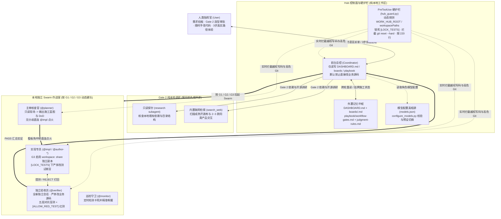

# agy-work-hub

**Pure-local, zero-dependency multi-project Human-AI orchestration plugin for Google Antigravity.**

> **English Summary** · [中文详版指南](#中文详版使用指南)
>
> `agy-work-hub` turns any multi-project workspace into a structured, guardrail-enforced Human-AI collaboration hub—with **100% local execution**, **zero remote accounts**, **configurable G0–G3 model routing (`models.json`)**, and **hardware-level PreToolUse guardrails (`hub_guard.py`)**.
>
> - **Context Firewall + Memory Cards**: The foreground coordinator reads/writes concise project memory cards (`boards/<slug>.md`, ≤ 180 lines) and never bloats its context with raw source files or noisy test logs.
> - **Configurable G0–G3 Gearbox (`models.json`)**: Switch presets (`balanced`, `economy`, `max-quality`, `inherit-all`) or customize any role (`coordinator`, `planner`, `impl_g1`, `impl_g2_g3`, `verifier_g1`, `verifier_g2_g3`, `monitor`, `research`) via [`configure_models.py`](./.agents/plugins/work-hub/scripts/configure_models.py) or natural language.
> - **Independent Verification & Red-Test Locking**: Separate `@impl` and `@verifier` sessions prevent self-grading. Bugfixes follow Red-Test-First (`[ALLOW_RED_TEST]` → `[LOCK_TESTS]`).
> - **Zero-Dependency Cross-Platform Guardrails**: [`hub_guard.py`](./.agents/plugins/work-hub/scripts/hub_guard.py) dynamically resolves `WORK_HUB_ROOT` / workspace paths across macOS, Linux, and Windows, locks test assertions under `[LOCK_TESTS]`, blocks destructive `git` commands (`reset --hard`, `clean -f`, `checkout --`, `add -A`), and prevents concurrent `DASHBOARD.md` overwrites.
>
> **2-Step Quick Start**:
> 1. Clone `agy-work-hub` into `<your-workspace>/agy-work-hub` (or `<your-workspace>/hub`).
> 2. Add `<your-workspace>/.agents/plugins.json`:
>    ```json
>    {
>      "entries": [
>        {
>          "path": "agy-work-hub/.agents/plugins"
>        }
>      ]
>    }
>    ```
> 3. (Optional) Run `python3 agy-work-hub/.agents/plugins/work-hub/scripts/configure_models.py --preset inherit-all` if you use custom providers or want every role to inherit your active session model.

---

<a id="中文详版使用指南"></a>
## 中文详版使用指南

`agy-work-hub` 是一套专为 **Antigravity** 打造的**纯本地、零外部账号依赖、模型完全可自由切换**的人机协作多项目总控插件。全部控制面资产、护栏脚本与技能手册均收敛在一个独立目录中，克隆挂载即可开箱使用。

---

## 一、 核心设计理念：三大痛点与破局方案

1. **防主窗口失忆（上下文防火墙 + 外置记忆卡）**
   - 总控主窗口只维护全局地图 [`DASHBOARD.md`](./DASHBOARD.md) 与单项目记忆卡 [`boards/<slug>.md`](./boards/_TEMPLATE.md)（严格 ≤ 180 行，护栏硬限 220 行 / 36KB）；
   - 大段源码阅读、编译调试、五层测试排障全部下沉到一次性子代理或 Swarm 独立会话中消化，只回传精炼结论。
2. **拒绝“左手写代码、右手夸通过”（独立盲测 + 红测锁死断言）**
   - 写代码的 `@impl` 与验收的 `@verifier` 物理分家、严禁共用同一会话；
   - 修 Bug 采用对抗式红测流：独立 `@verifier` 携带 `[ALLOW_RED_TEST]` 先写必挂复现测试，随后 `@impl` 携带 `[LOCK_TESTS]` 仅改业务实现——护栏硬拦截任何修改或放宽测试断言的行为。
3. **四档模型按需变速（[`models.json`](./.agents/plugins/work-hub/models.json) 单一真相源）**
   - 小修小补直接 G0 秒回（0 Swarm 消耗），中等任务走 G1 轻快双人队，跨模块/改 Schema/疑难 Bug 自动切 G2 主审攻坚，解耦并行大活走 G3 多工作副本兵团；
   - 支持一键切换 `balanced` / `economy` / `max-quality` / `inherit-all` 预设，也支持对任意角色精确指定模型或设为 `inherit`。

---

## 二、 全景系统架构图



---

## 三、 G0～G3 四档变速箱对比表

| 档位 | 适用判据（或人类口令） | Swarm 编制 | 核心链路 |
| :--- | :--- | :--- | :--- |
| **G0 · 闪答 / 直改** | 进度查询、改看板、模型调整、人类明示「直接改 / 不用走总控 / edit directly」，或纯调研 | 不建 Swarm（0 团队开销） | 主窗口秒回，或派只读 `research` / 调用 `search_web` |
| **G1 · 快刀开发** | **≤2 个业务文件**、边界清晰、不碰数据库/受保护契约、无需新选型；或「走快刀档」 | `@impl` + 独立 `@verifier` + `@monitor` | 跳过 `@planner`，本地独立盲测快审快交；打回 ≥2 次自动升档 G2 |
| **G2 · 主审攻坚** | **≥3 个业务文件/多模块**、Schema/迁移/受保护契约、需 Gate 2 选型、疑难 Bug 或 G1 打回 ≥2 次；或「走重装档」 | `@planner` + `@impl` + 独立 `@verifier` + `@monitor` | `@planner` 只读定蓝图与 DoD 并直连 `@impl` 开工 → `@verifier` 五层盲测（或红测锁断言） |
| **G3 · 并行战役** | 单项目内 **≥3 个解耦模块** 并行开发与联调 | `@planner` + 多路 `@author-*` (`share`) + `@verifier` + `@monitor` | `@planner` 严格划界零交叉写同文件 → 独立副本并发 → 合并后整体回归与五层盲测 |

---

## 四、 G0～G3 模型自由配置教程 (`models.json` + `configure_models.py`)

所有角色的模型配置集中在 [`.agents/plugins/work-hub/models.json`](./.agents/plugins/work-hub/models.json)，无需修改规则文档即可自由换模型。

### 1. 内置 4 套开箱预设 (`presets`)

| 预设名 | 适用场景 | 角色分配特点 |
| :--- | :--- | :--- |
| **`balanced`**（默认） | 日常主力开发与均衡性价比 | `coordinator`: `gemini-4-argon-medium`；`planner`: `gemini-4-carbon-high`；`impl_g1`: `gemini-4-hydrogen-high`；`impl_g2_g3` / `verifier_g2_g3`: `gemini-4-hydrogen-xhigh`；`verifier_g1` / `monitor`: `gemini-4-hydrogen-medium`；`research`: `inherit` |
| **`economy`** | 节省高阶配额 | `coordinator` / `research`: `inherit`；`planner` / `impl_g2_g3`: `gemini-4-hydrogen-high`；其余 Swarm 成员 `gemini-4-hydrogen-medium` |
| **`max-quality`** | 复杂架构攻坚与极限质量 | `coordinator`: `gemini-4-argon-high`；`planner`: `gemini-4-carbon-high`；`impl_*` / `verifier_g2_g3`: `gemini-4-hydrogen-xhigh`；`verifier_g1`: `gemini-4-hydrogen-high` |
| **`inherit-all`** | 跨供应商模型 / 通用开箱兼容 | 全部 8 个角色均为 `"inherit"`（拉起 `swarm add` 时省略 `model` 参数，自动跟随当前会话模型） |

### 2. 命令行与对话式修改示例

你可以直接用自然语言对总控说：**「切到 economy 预设」**、**「把 G2 的 planner 换成 inherit」**，或在终端执行 [`configure_models.py`](./.agents/plugins/work-hub/scripts/configure_models.py)：

```bash
# 1. 查看当前生效预设、禁用列表与 8 个角色绑定
python3 .agents/plugins/work-hub/scripts/configure_models.py --show

# 2. 列出全部内置预设及其模型详情（支持 --json 输出）
python3 .agents/plugins/work-hub/scripts/configure_models.py --list-presets

# 3. 一键切换预设（原子写回，自动校验不命中 blocked_models）
python3 .agents/plugins/work-hub/scripts/configure_models.py --preset economy
python3 .agents/plugins/work-hub/scripts/configure_models.py --preset inherit-all

# 4. 按角色单项定制（支持一次传多个 --set，设为 custom；支持设为 inherit）
python3 .agents/plugins/work-hub/scripts/configure_models.py \
  --set planner=gemini-4-carbon-high \
  --set impl_g2_g3=inherit

# 5. 管理禁用模型黑名单与全量结构校验
python3 .agents/plugins/work-hub/scripts/configure_models.py --block "gemini-3.8-pro"
python3 .agents/plugins/work-hub/scripts/configure_models.py --unblock "gemini-3.8-pro"
python3 .agents/plugins/work-hub/scripts/configure_models.py --validate
```

> 支持自定义配置路径 `--config <path/to/models.json>` 或环境变量 `WORK_HUB_MODELS_FILE`；任何非法角色、未知预设、黑名单冲突或损坏 JSON 均干净输出报错至 `stderr` 并返回非 0 退出码（零 Python Traceback）。

---

## 五、 2 步挂载到你的 Antigravity 工作区

### 第 1 步：把仓库放入你的工作区
在你的多项目工作区 `<your-workspace>` 下克隆（或复制）本仓库：

```bash
cd <your-workspace>
git clone <repo-url> agy-work-hub
# 也可直接命名为 hub/，hub_guard.py 均会自动识别
```

### 第 2 步：创建工作区插件指针 `.agents/plugins.json`
在工作区根目录新建（或编辑）`<your-workspace>/.agents/plugins.json`，指向 `agy-work-hub/.agents/plugins`：

```json
{
  "entries": [
    {
      "path": "agy-work-hub/.agents/plugins"
    }
  ]
}
```

> 如果你的控制面目录与某个业务项目共用同一个工作区根目录，也可以将 `agy-work-hub` 内全部文件直接置于 `<your-workspace>/` 并设置 `"path": ".agents/plugins"`——[`hub_guard.py`](./.agents/plugins/work-hub/scripts/hub_guard.py) 会严格区分控制面资产（`DASHBOARD.md`、`boards/`、`playbook/`、`.agents/`）与同级业务源码，不会误放行总控直接改业务代码。
>
> 如需自定义 Hub 根目录位置，可设置环境变量 `WORK_HUB_ROOT=/path/to/your-hub`。

### 开启 / 关闭与接入自有项目
- **一键开关**：在 Antigravity 左侧栏打开 **Skills & Customizations**，找到 **`Work Hub 多项目总控台` (`work-hub`)** 即可随时开启或停用（无需重启）；
- **接入项目**：复制 [`boards/_TEMPLATE.md`](./boards/_TEMPLATE.md) 为 `boards/<your-project>.md`，并在 [`DASHBOARD.md`](./DASHBOARD.md) 追加一行登记即可开始多项目总控调度。

---

## 六、 目录结构

```text
agy-work-hub/
├── .gitignore
├── LICENSE                                       # MIT License
├── README.md                                     # 本使用指南（中英概要 + 详版）
├── AGENTS.md                                     # 纯本地总控宪章
├── DASHBOARD.md                                  # 全局看板与灵感收件箱模板
├── boards/
│   ├── _TEMPLATE.md                              # 项目外置记忆卡通用模板
│   └── example-app.md                            # 示例项目记忆卡 (example-app)
├── playbook/
│   ├── workflow-gates.md                         # 纯本地六步链路与五层独立验收表
│   └── judgment-rules.md                         # 跨项目通用「如果…则…」规则库
└── .agents/
    └── plugins/
        └── work-hub/
            ├── plugin.json                       # 插件清单与 3 个快捷启动词
            ├── hooks.json                        # PreToolUse 生命周期护栏配置
            ├── models.json                       # G0~G3 模型路由单一真相配置
            ├── assets/logo.svg                   # 插件 SVG 图标
            ├── rules/AGENTS.md                   # 常驻轻量自动分流规则
            ├── scripts/
            │   ├── hub_guard.py                  # 跨平台零硬编码路径 PreToolUse 护栏
            │   ├── test_hub_guard.py             # hub_guard.py 离线子进程单测
            │   ├── configure_models.py           # 纯标准库模型配置 CLI
            │   └── test_configure_models.py      # configure_models.py 离线子进程单测
            └── skills/hub/
                ├── SKILL.md                      # /hub 四档编排技能
                └── references/                   # Swarm 启动手册与四大角色作业手册
```

---

## 七、 运行离线自检测试

全部脚本仅依赖 Python 3 标准库（兼容 Python 3.9+，支持 macOS / Linux / Windows）：

```bash
python3 -m unittest discover -v -s .agents/plugins/work-hub/scripts
```
